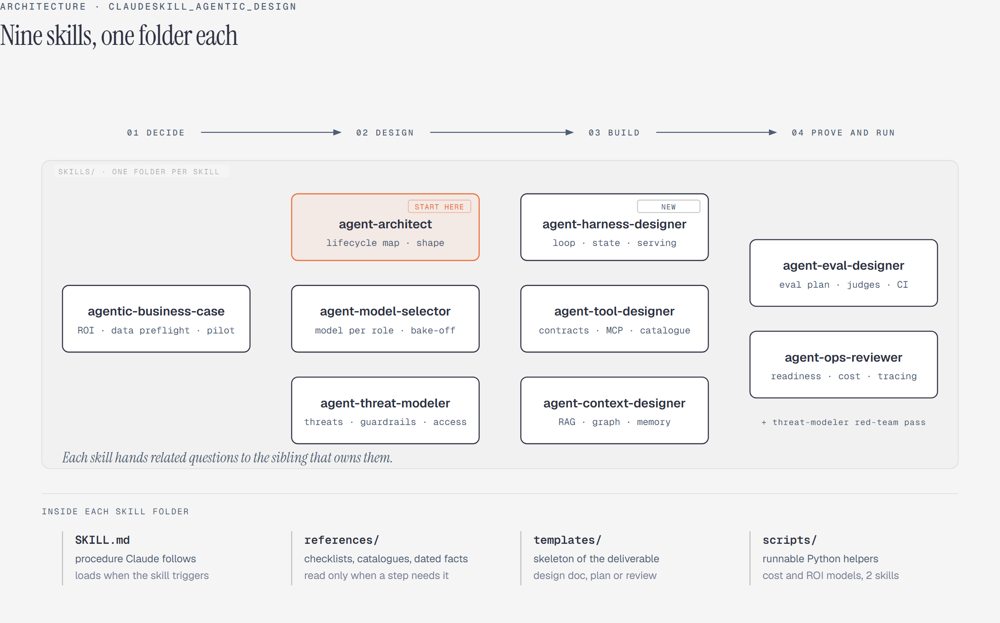

# Agentic AI design skills for Claude

Nine [Claude skills](https://platform.claude.com/docs/en/agents-and-tools/agent-skills/overview) that help you take an
AI agent from decision to production. Each one turns Claude into a reviewer or designer for one part of an agent
system: the business case, architecture and the end-to-end plan, model choice, the threat model and guardrails, the
runtime harness, tool and API contracts, retrieval and memory, evals, and operations and cost.

The guidance was distilled from 20 books on agentic AI, MCP security and API design (listed below), Andrew Ng's
letters and talks, and the books' companion code. It was cross-checked against current public sources such as the MCP
and A2A specifications, OWASP's lists and Anthropic's engineering posts. Then it was tested: a fresh Claude instance
that had never seen each skill ran it on a realistic scenario with planted problems, and an independent judge scored
the result.

**Quick install** (Claude Code, all skills, every project):

```bash
npx skills add quincysting/claudeskill_agentic_design -g -a claude-code --skill '*'
```

## The skills

| Stage | Skill | Use it to | Try asking |
|---|---|---|---|
| Decide | [`agentic-business-case`](skills/agentic-business-case/SKILL.md) | Pick use cases (concreteness test, scorecard, five-factor starting autonomy), check data readiness, build a business case with a runnable ROI model, plan the pilot, set up governance (incl. EU AI Act) | "Where should our bank start with AI agents?" |
| Decide, Design | [`agent-architect`](skills/agent-architect/SKILL.md) (start here) | Plan an agent end to end with the lifecycle map and stage gates; decide workflow vs agent per step, pick patterns, choose single vs multi-agent | "Give us the plan from decision to production" |
| Design | [`agent-model-selector`](skills/agent-model-selector/SKILL.md) | Choose a model and reasoning effort per role, decide prompt vs RAG vs fine-tuning vs RL, run a fair bake-off of whole configurations | "Should we fine-tune our clause classifier?" |
| Design, Prove | [`agent-threat-modeler`](skills/agent-threat-modeler/SKILL.md) | Threat-model an agent and design its defences: Rule of Two triage, tool access per action, guardrail layers, MCP hardening, human oversight; later the red-team pass | "Threat-model an email assistant that can send replies" |
| Build | [`agent-harness-designer`](skills/agent-harness-designer/SKILL.md) (new) | Design or review the agent's runtime: loop, run record, checkpoints and resume, budgets, kill switch, safe-mode replay, streaming, serving the agent as an API, harness tests | "Review my agent's runtime; how do we stop it fast?" |
| Build | [`agent-tool-designer`](skills/agent-tool-designer/SKILL.md) | Design the tools an agent calls as API contracts (receipts, failure categories, idempotency, versioning), the MCP servers that expose them, and the tool catalogue | "Review my support agent's tool definitions" |
| Build | [`agent-context-designer`](skills/agent-context-designer/SKILL.md) | Design retrieval (vector, graph or hybrid), agent memory and per-call context, including cache-friendly prompt layout | "My agent forgets what it already tried after 40 turns" |
| Prove and run | [`agent-eval-designer`](skills/agent-eval-designer/SKILL.md) | Write an eval plan: smoke suite, task sets, scorers, LLM-judge calibration, pass^k, sample sizes, harness tests, CI gates | "How many test cases do I need before launch?" |
| Prove and run | [`agent-ops-reviewer`](skills/agent-ops-reviewer/SKILL.md) | Apply the run gate: tracing (OpenTelemetry GenAI), monitoring, online evals, cost per successful run with a runnable cost model | "Is my agent production ready, and how do I halve its cost?" |

The skills know about each other. Each one stays in its lane and points to the sibling that owns a related
question, so `agent-architect` hands tool design to `agent-tool-designer`, the runtime to `agent-harness-designer`,
security to `agent-threat-modeler`, and so on. Install all nine for the best results.

## The end-to-end approach

The skills share one map, kept in
[`agent-architect/references/lifecycle-map.md`](skills/agent-architect/references/lifecycle-map.md). It has three parts.

**Four stages.** Decide, Design, Build, Prove and run. Each stage ends with a gate, a short list of exit criteria,
and the team does not move on until the gate passes. For example, the Decide gate asks for a use case concrete
enough that an engineer could prototype from one sentence, sources that pass a data readiness audit, a starting
autonomy level scored on five factors, and a business case that is fundable or pilot-only. The Run gate asks for a
run record, idempotent writes, a kill switch, safe-mode replay and live monitoring before release.

**Eight perspectives that cut across the stages.** Each has exactly one owner skill, so nothing is designed twice:

| Perspective | Owner | What it asks across the stages |
|---|---|---|
| API contracts | `agent-tool-designer` (the agent's own endpoint: `agent-harness-designer`) | Do usable APIs exist? Are tool contracts safe to retry and able to evolve? |
| Tool access | `agent-threat-modeler` | Which actions need which tier and identity? Does every call check the user's own entitlements? |
| Harness | `agent-harness-designer` | Can the run resume, stop within budget, be cancelled and be switched off fast? |
| Guardrails | `agent-threat-modeler` | What is enforced in the prompt, in input and output screening, and in code? |
| Evals | `agent-eval-designer` | Which decision do the evals serve, and can they fail? |
| Security hardening | `agent-threat-modeler` | Are MCP servers, tokens and the supply chain locked down? |
| Context and knowledge | `agent-context-designer` | Is the data ready, and does each call get the right knowledge? |
| Cost and operations | `agent-ops-reviewer` (ROI: `agentic-business-case`) | What does a successful run cost, and is the system watched? |

**A call order.** For a new agent, start with `agent-architect`; it tells you which sibling to call at each stage and
which reviews can run in parallel. For an existing agent, it routes you by symptom.

## Install

### With npx (recommended)

You need Node.js. The [`skills` CLI](https://github.com/vercel-labs/skills) installs straight from this repository:

```bash
# All nine skills for Claude Code, available in every project (~/.claude/skills/)
npx skills add quincysting/claudeskill_agentic_design -g -a claude-code --skill '*'

# Into the current project only (.claude/skills/); commit it to share the skills with your team
npx skills add quincysting/claudeskill_agentic_design -a claude-code --skill '*'

# See what's available, then pick
npx skills add quincysting/claudeskill_agentic_design --list
npx skills add quincysting/claudeskill_agentic_design -g -a claude-code --skill agent-architect --skill agent-threat-modeler
```

Add `-y` to skip the confirmation prompts. In Windows `cmd.exe`, write `--skill *` without the quotes. Leave out
`-a claude-code` to pick target agents interactively; the CLI can also install into Codex, Cursor and other
agents that read `SKILL.md` skills (see [Limits](#limits)). Later, `npx skills update` pulls new versions and
`npx skills remove agent-architect` removes a skill.

### Manually

Copy the skill folders into your personal skills directory (available in every project):

```bash
git clone https://github.com/quincysting/claudeskill_agentic_design.git
cp -r claudeskill_agentic_design/skills/* ~/.claude/skills/
```

On Windows (PowerShell):

```powershell
git clone https://github.com/quincysting/claudeskill_agentic_design.git
Copy-Item -Recurse claudeskill_agentic_design\skills\* $HOME\.claude\skills\
```

To share them with a team through one repository instead, copy them into that project's `.claude/skills/`
folder and commit it.

Whichever way you install, start a new Claude Code session afterwards. The skills load automatically and trigger
when your request matches their description. You can also call one by name, for example `/agent-architect`.

### Claude apps and the API

Each folder under `skills/` is a standard skill (a `SKILL.md` with YAML frontmatter plus supporting files). Where
your Claude product supports uploading custom skills, zip the individual skill folder and upload it.

## How the repo is organised



*Each skill is one folder under `skills/`. `SKILL.md` holds the procedure (inputs to gather, steps, decision
tables, output shape, quality bar); `references/` holds the depth Claude reads only when a step needs it, including
`aws-implementation-notes.md` in eight skills; `templates/` holds the deliverable skeletons. The diagram's source is
[`docs/skill-map.html`](docs/skill-map.html).*

Two skills include Python helpers that need only the standard library:

- `agent-ops-reviewer/scripts/cost_model.py`: expected, likely-high and capped worst-case cost and latency per
  request, monthly cost at peak, and what-ifs. Run it with `--selftest` to check it, or pass your own JSON spec.
- `agentic-business-case/scripts/roi_model.py`: monthly ROI, payback, breakeven containment, sensitivity and a
  fundable / pilot-only / not-fundable verdict. Running it with no arguments runs its self-check.

## What's new

**October 2026, v2: one end-to-end approach.** Nine books were added to the sources (production agent books, MCP
hardening, agent security and API design), together with their companion repos, related public repos and Andrew Ng's
letters on agentic workflows. The changes:

- A new skill, `agent-harness-designer`, for the runtime around the model: the loop, run record, checkpoints and
  resume, budgets checked before every call, a kill switch with a draft-only level, safe-mode replay, streaming and
  cancellation, serving the agent as an API, and tests for the harness itself.
- A lifecycle map in `agent-architect`: four stages, eight cross-cutting perspectives with one owner each, and a
  gate per stage. The other skills say which gate items they supply.
- Tools are treated as API contracts (`agent-tool-designer`): receipts, failure categories, three kinds of
  idempotency, never breaking a contract by default, schema diffs in CI, valid next actions in results, and a
  governed tool catalogue.
- `agent-threat-modeler` gains MCP hardening, a three-layer guardrail model, Rule of Two triage, the OWASP Agentic
  Top 10 and MAESTRO, permission tiers per action, and approvals bound to the exact action. It now starts at Design.
- Smaller additions elsewhere: graph or hybrid retrieval and governed memory entries; a first smoke suite, harness
  tests and error analysis in evals; cost per successful run and a run gate in operations; a data-readiness preflight
  and five-factor autonomy scoring in the business case; bake-offs that compare whole configurations.
- The five most-changed skills were re-tested cold on new scenarios with planted problems. An independent judge
  scored them 4.67 to 4.83 out of 5, with 38 of 39 planted problems caught, and its fixes are in this release.

**October 2026: lessons from hands-on AWS labs.** The skills were checked against a set of hands-on AWS labs
(AgentCore identity and token exchange, gateways and policy, memory, evaluations, observability, multi-agent state,
graph and vector data). Where a lab exposed a gap, the fix went into the vendor-neutral core as a rule, checklist
item or common mistake. Examples: exchange the token at every hop instead of forwarding it, fail closed on missing
token claims, use conditional writes for shared memory, count missing eval sessions as failures, and keep volatile
fields out of the cached prompt prefix. Seven skills gained `references/aws-implementation-notes.md`, which maps
each principle to AWS services and lists the gotchas the labs hit. `agentic-business-case` covers the same ground
in a section of its governance reference. The four most-changed skills were re-tested cold on new scenarios with
planted problems, and an independent judge passed all four.

## How these skills were built

1. Eleven books were converted to text and each was read in full, chapter by chapter, to produce a per-book digest.
   In October 2026 nine more books, their companion repos, related public repos and Andrew Ng's letters were reviewed
   for agent-building signal, and the earlier companion repos were re-read for harness, contract and guardrail
   patterns.
2. All chapters (137, then 96 more) were mapped onto 20 topics, down to section level, and the books'
   disagreements were listed.
3. A 20-chapter reference guide (about 170,000 words) was written from those chapters plus companion code and
   current public sources, with citations checked and claims spot-checked against the books.
4. The skills were distilled from the guide: decisions, defaults, thresholds and checklists rather than summaries.
5. Each skill was dry-run by its author, then tested cold by a separate Claude instance on a held-out scenario.
   An independent judge scored the outputs (all eight passed, 4.0 to 4.8 out of 5 on followed-the-procedure,
   specific, correct, actionable and well-scoped), and the testers' notes were fixed in the published versions.

Citations such as `[DEFGUIDE ch5]` in the reference files point to the books below; each skill's Sources section
maps the keys to titles. You do not need the books to use the skills.

## Sources

| Key | Book |
|---|---|
| DEFGUIDE | *AI Agents: The Definitive Guide*, Nicole Koenigstein (O'Reilly) |
| MCP | *AI Agents with MCP*, Kyle Stratis (O'Reilly) |
| EVALS | *AI Evals in Practice*, Caio Incau (Packt) |
| AGENTICAI | *Agentic Artificial Intelligence*, Pascal Bornet et al. |
| MESH | *Agentic Mesh*, Eric Broda and Davis Broda (O'Reilly) |
| ILLUSTRATED | *An Illustrated Guide to AI Agents*, Maarten Grootendorst and Jay Alammar (O'Reilly) |
| BUILDAGENTIC | *Building Agentic AI*, Sinan Ozdemir (Pearson) |
| BUILDAPPS | *Building Applications with AI Agents*, Michael Albada (O'Reilly) |
| DLLMA | *Designing Large Language Model Applications*, Suhas Pai (O'Reilly) |
| SYSTEMS | *Systems Thinking for Agentic AI* |
| ENTERPRISE | *The Agentic Enterprise*, Babak Hodjat et al. (O'Reilly) |
| PRODGUIDE | *Agentic AI Systems: The Complete Guide for Building Production AI Agents*, Patrick Andrei |
| PLAYBOOK | *Agentic AI Playbook*, Helena Liu |
| KGRAG | *Building AI Agents with LLMs, RAG, and Knowledge Graphs*, Salvatore Raieli and Gabriele Iuculano (Packt) |
| HARDMCP | *Hardening MCP Servers* (GitforGits) |
| AISEC | *Agentic AI for Cybersecurity*, Omar Santos (Pearson); defensive chapters only |
| APIARCH | *Mastering API Architecture*, James Gough, Daniel Bryant and Matthew Auburn (O'Reilly) |
| APIMGMT | *Continuous API Management*, 2nd ed., Mehdi Medjaoui, Erik Wilde, Ronnie Mitra and Mike Amundsen (O'Reilly) |
| RESTCOOK | *RESTful Web API Patterns and Practices Cookbook*, Mike Amundsen (O'Reilly) |
| FASTGENAI | *Building Generative AI Services with FastAPI*, Alireza Parandeh (O'Reilly) |

Andrew Ng's letters in *The Batch* and his talks are cited as `[NG <title>, <date>]`, and each skill's Sources section
gives the letter's URL. Related public repos that were reviewed include
[12-Factor Agents](https://github.com/humanlayer/12-factor-agents), [aisuite](https://github.com/andrewyng/aisuite),
Mike Amundsen's [apis-and-agents](https://github.com/mamund/apis-and-agents), and the CoSAI
[secure-ai-tooling](https://github.com/cosai-oasis/secure-ai-tooling) risk map.

The skills paraphrase and synthesize; they contain no book text beyond short attributed phrases. This project is
not affiliated with the authors or publishers. If you find the guidance useful, the books are worth reading.

## Limits

- Fast-moving facts (model names, prices, MCP and A2A versions, OWASP lists, EU AI Act dates) are dated
  October 2026 and kept in clearly named files such as `references/current-facts-2026-10.md`,
  `references/model-landscape-2026-10.md`, `references/framework-vocabulary-2026-10.md` and
  `references/eu-ai-act-2026-10.md`. Check them before relying on
  them, and send a pull request when they change.
- The AWS notes (`references/aws-implementation-notes.md`) are dated October 2026 too. AWS services change
  quickly; verify a setting in the AWS documentation before you rely on it.
- The skills give design and review guidance. They do not replace testing your own system, and the regulatory
  material in `agentic-business-case` is not legal advice.
- The skills are written for Claude. Other agents that read `SKILL.md` files may use them, but they were only
  tested with Claude.

## Contributing

Issues and pull requests are welcome, especially updates to the dated reference files and reports of scenarios
where a skill gave weak or wrong advice. Please keep `SKILL.md` under 500 lines and put depth in `references/`.

## License

[MIT](LICENSE)
