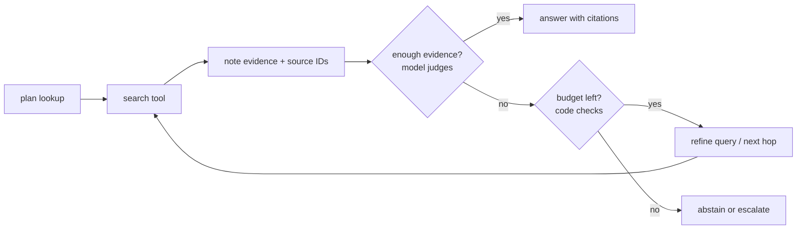

# Retrieval pipeline reference

Depth for Procedure steps 3-4. Citation keys like [SYSTEMS ch5] are expanded in SKILL.md under Sources.

Contents: 0 Source-readiness audit · 1 Mode (1.1 vector, graph or hybrid by query type) · 2 Index time (2.3 metadata, allow and deny rules, 2.4 embeddings and fine-tuning, 2.5 stale documents and idempotent indexing, 2.6 mixed or sensitive sources, 2.7 ingest checks) · 3 Query time (3.2 rank fusion or weighted scores, 3.4 several indexes, 3.7 chunk order, 3.8 cite and verify) · 4 Agentic retrieval · 5 Graph and structured retrieval (metric catalog, entitlements; 5.1 one store per access pattern; 5.2 building a graph with an LLM; 5.3 model-written graph and SQL queries) · 6 Caching · 7 Debug order

A RAG system is two pipelines that meet at an index. Index time: parse, chunk, attach metadata, embed, index. Query time: understand the query, search wide, narrow, assemble, generate. Read query time as a funnel. The first stage is judged by **recall** (did the evidence reach the candidate set at all?), later stages by **precision** (how much of what reaches the model is useful?). Nothing downstream recovers a document the first stage missed [DLLMA ch12 §The RAG Pipeline], and a failure usually runs down the chain: bad chunking, then weak retrieval, then poor ranking, then a thin context [SYSTEMS ch5 §5.10 Retrieval Quality Shapes Answers].

```
index time:  sources -> parse -> chunk (+doc/section context) -> metadata (+ACL, version) -> BM25 index + vector index
query time:  question -> split instructions / rewrite? -> BM25 ∥ dense (ACL pre-filter) -> RRF fuse (~50)
             -> rerank -> floor -> keep 3-5 -> dedupe/compress -> insert with IDs -> answer with citations | "not found"
```

## 0. Audit the sources before tuning the retriever

No reranker recovers an answer the corpus gets wrong. When an agent that worked in testing gives wrong answers on real data, the cause PLAYBOOK sees most often is the data, not the model [PLAYBOOK ch3]. Run this audit before the first index build, and again before any retrieval tuning:

- **Coverage.** List the 30 to 50 questions the agent will face most often and check that each has one clear, current answer in the corpus. Archive whatever is no longer in force: an agent can't tell a live policy from a retired one unless the difference is explicit. Merge documents that disagree, or mark which one governs [PLAYBOOK ch3 §The Knowledge Base Audit].
- **Warning signs.** For a knowledge base: articles that name retired products or policies, nothing edited in over 12 months, gaps in common-question coverage. For structured sources: more than 20% blank fields, the same record duplicated, no update in 90 days [PLAYBOOK ch3 §The Data Audit Framework].
- **The 90% rule is for fields.** Any structured field the agent uses to make a decision or produce customer-facing output should be at least 90% complete and accurate [PLAYBOOK ch3 §What 'Good Enough' Actually Means]. It is a threshold for record fields (a plan tier, a ticket category, an owner), not for knowledge-base articles. Articles pass the coverage, staleness and documentation checks instead.
- **Documentation test.** Give the material to someone who doesn't do the job, ask them to follow it without help, and fix it where they get stuck [PLAYBOOK ch3 §The Documentation Test]. PLAYBOOK writes the test for workflow documentation, in line with its new-hire framing of agents [PLAYBOOK ch1 §How To Think About AI Agents]; it works on a corpus too.
- **Answer-first writing.** State the answer at the top of each article, use specific wording ("within 5 business days", not "promptly"), and keep one topic per document [PLAYBOOK ch3 §Writing Content That Agents Can Use]. Such documents chunk into units that match questions and carry their own context (section 2.2). Start with the highest-traffic content.
- **Volatile data behind a live query.** Order status, stock levels, balances and prices belong in a live tool that the agent queries at run time, not in the index [PLAYBOOK ch3 §Know the Difference Between Stable and Volatile Data] (memory-design.md §1).
- **Owner and schedule.** One named owner per source and a review schedule (PLAYBOOK says quarterly at minimum, monthly for customer-facing content). Watch the escalation rate per topic: a rising rate often means the content behind it has gone stale [PLAYBOOK ch3 §Keeping It Current]. The continuous version of this check is the derived status and owner review queue in section 2.5.

If more than two or three items on the readiness checklist fail, narrow the pilot to the cleanest source instead of indexing everything [PLAYBOOK ch3 §The Data Readiness Checklist]. Whether a clean-up is worth funding is a question for agentic-business-case. For conflicts that survive the audit, give the agent a conflict rule: detect the disagreement, rank the sources by type, recency, authority, specificity and traceability, then answer from the top-ranked one with a citation, or ask which one governs [PRODGUIDE ch9 §Conflict Rules and Source Quality].

## 1. Pick the mode

| Mode | Use when | Avoid when |
|---|---|---|
| No retriever, whole corpus in a cached prefix | Small, stable corpus that is the same for every user. Anthropic's contextual-retrieval post suggests this below about 200k tokens (external) | Corpus grows or churns; permissions differ per user; cost-sensitive traffic |
| Always-retrieve pipeline | Private or changing corpus; nearly every question needs it | Many inputs need no lookup (greetings); route those around retrieval [BUILDAGENTIC ch2] |
| Retrieve-or-not gate | Open-domain questions, large models, latency matters | Proprietary, regulated or fast-changing data. Always retrieve there and let the model abstain [DLLMA ch12 §Deciding When to Retrieve] |
| Retrieval as a tool (agentic RAG) | Several sources; the next lookup depends on the last result; one query can't cover the corpus | One well-designed lookup already answers reliably |
| Plan-and-search research loop | Open-ended research over many pages | Interactive latency; simple lookups |
| Text-to-SQL with retrieved schema hints | The answer lives in tables | Free text; governed numbers (use a metric catalog) |
| Metric catalog (section 5) | The answer is a governed number: a KPI, regulatory ratio, financial figure or SLA value | Exploratory questions over tables nobody has defined metrics for |
| GraphRAG, beside hybrid search (section 1.1) | Relation chains or corpus-wide themes that hybrid search measurably fails on, and you can keep the graph current | Independent documents; questions that name no entity; nuance in the prose matters; no budget to maintain a graph |

The books disagree on the default. One presents agentic RAG as the natural next step [ILLUSTRATED ch4 §Agentic Retrieval-Augmented Generation]. Two others keep the fixed pipeline as the default because it is easier to build, test, cache, monitor and tune ([SYSTEMS ch5 §5.15 Advanced RAG: From Retrieval to Navigation]; [DLLMA ch10 §LLM Interaction Paradigms]). The measurements back the cautious position (section 4), so start with a fixed pipeline and add agent control only when you can name the reason.

Long context does not replace retrieval. Bigger windows cost more per call, add latency, and give no guarantee that the model finds the one relevant passage. Needle tests use unrelated filler, while real distractors are related text ([DLLMA ch12 §RAG Versus Long Context]; [BUILDAPPS ch6]). Chroma's Context Rot study (external, 2025) found accuracy dropping with input length across 18 models, and dropping faster when distractors were present.

### 1.1 Vector, graph or hybrid: choose by query type

A graph fixes three weaknesses of chunk retrieval: chunks lose the relations between documents, concatenated chunks repeat text, and a handful of chunks can't stand for the whole corpus [KGRAG ch7 §Retrieving information with a knowledge graph and an LLM]. It loses where the prose matters. A graph keeps entities and relations and drops the nuance of the text, so GraphRAG underperforms on abstractive questions and on questions that name no explicit entity to start from [KGRAG ch7 §Ongoing challenges in knowledge graphs and GraphRAG].

| Query type | Example | Route to |
|---|---|---|
| Exact identifier, name or code | "What does E1042 mean?" | Keyword (BM25), inside hybrid |
| Paraphrase or concept | "How do refunds work after a failed payment?" | Dense vectors, inside hybrid |
| Literal and conceptual mixed | "SKU 4471 but in a lighter fabric" | Keyword plus vector hybrid: **the default** |
| Relationship chain across entities | "Who owns the service behind this error, and what changed there this week?" | Graph: find the entity, then k-hop or path retrieval [KGRAG ch7 §Graph-guided retrieval] |
| Corpus-wide theme | "What do customers complain about most?" | Graph community summaries [DLLMA ch12 §Retrieve] |
| No explicit entity, or nuance matters | "Do our replies to enterprise clients sound too stiff?" | Vectors, not the graph |
| Counts, sums, filters over records | "How many refunds over $500 last month?" | Recurring question shapes: a vetted parameterised template the model fills (section 5.3). Exploratory one-offs: text-to-SQL on the system of record (section 5) |
| Governed number | "What was last quarter's churn rate?" | Metric catalog (section 5) |

**Default: hybrid first, a graph only when measured, then route.** Keyword plus vector hybrid serves most traffic. Add a graph only when your test set holds relationship or corpus-wide questions that hybrid search measurably fails, and you can keep the graph current (section 5.2). Then put a router in front of the stores instead of replacing one with the other. The books split here. BUILDAPPS says GraphRAG "frequently produces better results" but gives no measurement [BUILDAPPS ch6 §Using Knowledge Graphs]. SYSTEMS and DLLMA use it only where the domain justifies the cost, and warn that bad relationships are worse than missing ones ([SYSTEMS ch5 §5.15 Advanced RAG: From Retrieval to Navigation]; [DLLMA ch12 §Retrieve]). KGRAG makes the strongest case for graphs and still ends at HybridRAG, graph and vector retrieval in one system, which did better on financial questions in the work it cites [KGRAG ch7 §GraphRAG applications]. It mentions a router that picks the store per query as something future systems may add, not as current practice. Routing is this skill's recommendation for mixed traffic once both stores exist. GraphRAG has no standard benchmarks, so the decision rests on your own question set (evaluation.md §1).

**Routing.** [KGRAG ch6 §Query routing] lists five router designs: logical rules, keyword matching, zero-shot classification by an LLM, function calling with one function per route, and a semantic router that matches the query against embedded example queries. Rules are fast and deterministic but blind to meaning; LLM routers understand the query but vary from run to run. Use rules where they can tell (a ticket ID goes to keyword search, a known metric name to the metric catalog), a semantic router built from logged queries for the rest, and hybrid search as the fallback route when the router is unsure. Score routing accuracy separately from retrieval (evaluation.md §2).

## 2. Index time

### 2.1 Parsing
- Extracting sections, tables and figures from mixed formats is where a large share of RAG failures start [DLLMA ch11 §Chunking]. Before tuning anything else, inspect the parsed output of each document type: multi-column PDFs, tables, headers and footers, scanned pages.
- Keep structure: heading path, table rows with their headers, page numbers (for citations).

### 2.2 Chunking: climb the ladder only as far as measurement says
| Rung | What | Use when |
|---|---|---|
| Sliding window with overlap | Fixed-size chunks; overlap keeps a sentence cut at a boundary whole in one of them (one book shows 100-token chunks with 20 tokens of overlap) [SYSTEMS ch5] | Unstructured text, a first baseline |
| Structure-aware | Cut at paragraphs and sections; carry the heading path as metadata | **Default** for manuals, policies, contracts, wikis |
| Layout-aware | Knows a subsection's scope, so its title is prepended to every chunk from it; vision retrievers embed whole pages | Long structured reports; layout carries the meaning |
| Semantic | Group sentences by topic shift | Rambling text without structure |
| Late chunking | Embed the whole document with a long-context embedder, then pool per segment | Chunks depend heavily on document context |
| Small-to-big | Embed sentences, return the parent chunk | Precise matching, but the answer needs surrounding text [DLLMA ch11 §Chunking] |

- **Chunk context.** A chunk loses meaning once it is cut out of its document. In DLLMA's filing example, page 5 says all figures are in millions and page 84 says $213.45, so no chunk from page 84 carries the unit [DLLMA ch11 §Chunking]. The fix is to prepend document title, section path and, where needed, a 50-100-token LLM-written situating sentence before both embedding and BM25 indexing (Anthropic's contextual retrieval, external; figures in provider-notes.md).
- **Chunk size.** No book gives an ideal size. Test two or three granularities against your real queries [DLLMA ch11 §Chunking]. Keep an answer from being split across a boundary [EVALS ch7].

### 2.3 Metadata schema (per chunk)
`chunk_id, doc_id, title, section_path, section_role, page, source, doc_type, version or effective_date, language, product, tenant_id, acl_groups, deny_scopes, content_hash, pipeline_version, batch_id, indexed_at`

- Filter on these inside the search ([SYSTEMS ch5 §5.9 Metadata Filtering]). Filters can come from rules or from an LLM that parses the query [DLLMA ch12 §Retrieve].
- **ACLs are the field most often missing.** Embeddings copied out of secured systems lose the access rules that governed them [MESH ch1 §The Agent Opportunity]. Carry them as metadata, sync them when the source changes, and enforce them per query from the authenticated identity.
- **Allow lists are not enough: carry deny rules too.** Ethical walls, information barriers, conflict screens, legal holds and need-to-know exclusions bar a person who would otherwise qualify: a lawyer in the litigation group who is screened off one matter, an analyst behind a research barrier. An allow list can't say that. Store `deny_scopes` beside `acl_groups` and evaluate both inside the search for the caller: a chunk is visible only when the caller matches an allow group and no deny scope, and deny wins. A new wall is an ACL change. Push it to the index metadata, invalidate every cache keyed by the old scope (section 6), and purge recalled memory, session state and checkpoints that hold content from the newly barred scope (memory-design.md §6). Test it with a user walled off after the fact: on the next query they lose access everywhere, caches and memory included.
- **`section_role`** says what kind of text a chunk is: body or holding, dissent, headnote or editorial summary, a party's quoted argument, a superseded clause. The citation check in section 3.8 uses it.

### 2.4 Embeddings (basics; model choice goes to agent-model-selector)
- Use the same model for queries and documents. Use the similarity measure the model was trained with. With unit-normalised vectors, dot product equals cosine and costs less ([BUILDAGENTIC ch2]; [DLLMA ch11 §Similarity Measures]).
- Short query against a long passage is an asymmetric workload, so prefer models trained for asymmetric search [DLLMA ch11 §Semantic Search].
- **Similarity is not relevance.** "He is not retiring" scored 0.787 against "announced his retirement" and 0.768 against "did not announce his retirement" [DLLMA ch11 §Similarity Measures]. Absolute scores vary by model, so calibrate any threshold on your own data.
- **The query must use the index's distance.** An approximate index is built for one distance metric. A query that orders by a different distance function can't use it and silently falls back to an exact scan: correct results, with latency that grows with the corpus. Check the query plan once per query shape, and give the filter columns used beside the vector search their own index.
- **Dimension and metric are fixed when the index is created.** The vector field's dimension must equal the embedder's output size. An embedder change is a full re-index into a new index, switched over with an alias, not an in-place update.
- Switching embedders is rarely the first fix. Seven embedders on the same evidence scored recall@10 between 0.610 and 0.720, the top five within 0.021 of each other, and domain mattered more than model [BUILDAGENTIC ch3 §Evaluating Evidence Retrieval]. Fix parsing, chunking, filters and corpus gaps first.
- At scale: 100M 768-dim float32 vectors take about 300 GB. Matryoshka truncation and binary quantisation cut that with some loss [DLLMA ch11 §Optimizing Embedding Size]. Fine-tune with hard negatives when the vocabulary is unusual; a few thousand pairs can be enough [DLLMA ch11 §Fine-Tuning Embedding Models].
- **Fine-tune the embedder before you replace it**, once parsing, chunking and filters are fixed and the domain vocabulary is unusual (internal product names, legal or clinical terms). Fine-tuning an existing embedder costs far less than training one from scratch and fits it to your domain [KGRAG ch5 §Comparison between RAG and fine-tuning]. Where labelled pairs are missing, a large model can generate synthetic training pairs [KGRAG ch5 §Comparison between RAG and fine-tuning]; then test on real logged queries, because test questions generated the same way as the training pairs inflate recall (evaluation.md §1). A fine-tuned embedder is a new embedder: plan a full re-index behind an alias (above).

### 2.5 Freshness, staleness and deletion
- Re-index on change, keyed by `content_hash`. Retire superseded versions or mark them. Stale and conflicting documents leave the model guessing ([SYSTEMS ch16 §16.10 Retrieval-Augmented Generation Integration]; [DLLMA ch12 §Limitations of RAG]).
- **Make indexing idempotent.** Each run reads only its own increment (documents new or changed since the last good run), not the whole source again, and upserts by a stable chunk ID (document ID + chunk position). The content hash decides whether a chunk needs re-embedding. When a changed document yields fewer chunks, delete the leftovers. Confirm that the index honours the IDs you supply. If it assigns its own, every re-run duplicates chunks: delete by document ID before inserting, or deduplicate by chunk ID at query time (section 3.6) and count duplicates as an index-health metric (section 2.7).
- **Ingest generation.** Keep one counter per index, the ingest generation. Every ingest run that passes its checks (section 2.7) increments it, incremental runs included, and the query path reads it. Retrieval and answer caches put it in their keys (section 6). An index or alias name is not a version here: nightly upserts into a live index never change it, so cached "not found" results would outlive the ingest that added the documents. Tag every chunk with the `batch_id` of the run that wrote it.
- Deleting a source must remove its chunks, vectors and any cached retrievals or answers that used them.
- **Primary-authority corpora** (case law, statutes, regulations, standards): age is not staleness. An old decision can still be good law and a recent one can already be overturned. Take status from an authoritative feed (overruled, reversed, amended, repealed, withdrawn, superseded), store it as metadata, and re-check it at answer time for anything cited. The age limits and recency tie-breakers below don't apply across such documents. Treatment can cover one point rather than the whole document, so show it beside the citation; where you only know a document-level status, keep the document out of authoritative use and say why.

**When documents carry no version or effective date** (the usual case for wikis), derive a status per document at index time and store it as metadata: `status` (`current`, `needs_review`, `deprecated`, `archived`), `last_modified`, `owner`, `supersedes`.

| Signal | How to detect it | Action |
|---|---|---|
| Explicit markers | Archive spaces, "deprecated" or "obsolete" labels and banners, an old year in the title, "replaced by" links | `deprecated` or `archived`; excluded by filter |
| Near-duplicate pairs | Document-level embedding or shingle overlap within one space or topic, above a threshold you calibrate on a reviewed sample | Newer `last_modified` stays `current`; the older one becomes `needs_review` with a candidate `supersedes` link |
| Age by document type | `last_modified` older than a per-type limit (start around 12 months for how-tos and procedures, longer for stable policies; tune) | `needs_review`; still retrievable, but flagged |
| Feedback | Users report "this is outdated", or mark answers wrong that cited the document | Owner review queue |
| Conflict at answer time | Two retrieved items disagree | Prefer `current`, then the newer one; tell the user the sources disagree and cite both |

- **Owner review queue.** Send `needs_review` documents to their owner (page owner or space admin) with three choices: keep (resets the clock), update, deprecate. Without that loop the flags only pile up.
- **Freshness against relevance.** A blanket recency boost pushes newer but less relevant documents up. Instead: filter out `deprecated` and `archived`, use recency as a tie-breaker inside near-duplicate clusters, and apply a mild age decay only to document types that age (release notes, how-tos). Check the effect on the stale-version test slice.
- Put `last updated <date>` and `status` in each evidence header, and tell the model to mention the date when it cites a `needs_review` document.

### 2.6 Mixed or sensitive sources (tickets, email, chat logs)

Some sources are knowledge, live state and personal data at once. A helpdesk ticket holds a resolution other people could reuse, the reporter's current case status, and names, devices and sometimes credentials. Don't index such records raw into a shared corpus. Split them by use:

| Use | Store | Built how | Who can read it | Retention |
|---|---|---|---|---|
| Reusable knowledge | Sanitised "case card" index: problem, environment, symptoms, resolution steps, outcome, source ticket ID | Batch job over resolved tickets with a confirmed fix. A PII and secret scrubber removes names, emails, person-linked hostnames and credentials before any model sees the ticket; an LLM drafts the card from the scrubbed text, through an endpoint approved for that data class; the scrubber runs again on the draft; review a sample before publishing. Rotate any credential the scrubber finds | Everyone allowed that knowledge class. Exclude sensitive categories (security incidents, HR, legal) or give them their own ACL | Same age limit and owner review as how-tos (section 2.5). Regenerate or delete the card when its ticket is deleted or reopened |
| The user's own records | No copy: a live tool on the source system | Queried at run time, scoped to the reporter and the assignee group | Per the source system's ACL | The source system's retention |
| Analytics and evaluation | Pseudonymised extracts | Scheduled export | Eval and ops team | Per policy; included in the deletion map |

- A case card is weaker evidence than an official document: a fix that worked once for one person. Label its trust tier (section 3.4).
- Collect only what is needed and pseudonymise before storing [AGENTICAI ch7]. Copied text loses the source's access rules unless you carry them as metadata [MESH ch1 §The Agent Opportunity].
- The same split applies to memory. A user's open tickets are live state to fetch, not something to remember (memory-design.md §1).
- In a single-company deployment, read "tenant" in this skill as the organisational boundary that matters (business unit, region, role group). The filtering rules stay the same.

### 2.7 Check every ingest

An ingest run that finishes without an error can still have indexed nothing: a source path one level off, a parser that returned empty text, a trigger that never fired, a link step that matched no rows. An empty or partial index raises nothing. It produces "not found" answers, or ungrounded ones, and the team starts tuning prompts (section 7). After every run:
- **Assert per source:** documents seen > 0; chunks written roughly in line with the document count; an embedding for every chunk; and a known-answer canary query per source that returns its document. A zero count fails the run and raises an alert, not a warning.
- **Validate records before load** (required fields, types, and the fields later steps link on) and send rejects to a quarantine with a reason.
- **Backfill; don't rely on the trigger alone.** Event-triggered indexing sees only events that arrive after it is wired up and working. Run a backfill for what existed before, and a periodic reconcile that compares the source listing with the index listing to catch whatever arrived while the trigger was broken.
- **Re-index after pipeline changes.** A change to parsing, chunking or linking code does nothing to chunks already indexed. Record `pipeline_version` on each chunk so you can tell which version built it.
- **Make a bad ingest reversible**, so it is rolled back instead of repaired in place. Roll back an incremental run by batch: remove the chunks that carry its `batch_id` and re-ingest the documents it changed from their last good source version. Keep alias swaps for full rebuilds (an embedder or pipeline change, section 2.4): build a new index, run the same checks on it, and switch the alias only when they pass. A passing run, a rollback and an alias switch each advance the ingest generation (section 2.5), because each changes what queries can find.
- With a graph, add the required-path checks from section 5 to the same gate.

## 3. Query time

### 3.1 Understand the query
- Split instructions from the question before searching. "Summarise our refund policy as a table" searches for "refund policy" [DLLMA ch12 §Rewrite].
- Rewriting options [DLLMA ch12 §Rewrite]:

| Technique | Cost | Helps | Hurts |
|---|---|---|---|
| Synonym / pseudo-relevance expansion | Low | Vocabulary mismatch | Topic drift |
| LLM expansion: HyDE, Query2doc (search with a short hypothetical answer) | One small-model call per query | Users and documents use different words | Exact-identifier queries; drift |
| Document-side enrichment: doc2query, contextual chunk text | Paid once, at index time | Tight query latency | Corpora that churn faster than you can re-process |
| Decomposition into sub-queries | One call plus N searches | Comparisons, multi-part questions | Simple lookups |

Measure recall@k with and without rewriting, per query type, and keep it only where it helps.

### 3.2 First stage: hybrid search with rank fusion
- Run BM25 and dense search **in parallel** [SYSTEMS ch12] and fuse by rank. BM25 catches identifiers, error codes, product names and jargon that embeddings blur. Dense search catches paraphrase. Real query mixes contain both kinds ([SYSTEMS ch5 §5.7 Hybrid Search]; [DLLMA ch12 §Retrieve]; [BUILDAGENTIC ch5 §BM25: Keeping It Old School]).
- Reciprocal rank fusion uses ranks, so BM25 and cosine scores never need a common scale. Most search engines ship it built in (Elastic defaults k to 60; external).

```python
def rrf(*rankings, k=60):                      # each ranking: list of doc ids, best first
    score = {}
    for r in rankings:
        for pos, doc in enumerate(r, 1):
            score[doc] = score.get(doc, 0) + 1 / (k + pos)
    return sorted(score, key=score.get, reverse=True)
```

- **Weighted scores are the alternative to RRF.** Normalise each list's scores to a common range, then combine them with a keyword weight α. KGRAG gives 0.4 or 0.5 as typical and notes that some sources suggest 0.3 [KGRAG ch6 §Keyword-based search and hybrid search]. Check the direction before copying a number: the book's formula and its prose disagree on which end of α means keyword, and engines differ too. Use weighting when one side should count more (identifier-heavy traffic toward keyword, paraphrase-heavy traffic toward dense), and tune α on the identifier and paraphrase slices. Otherwise keep RRF, which needs no normalisation and no tuning. Some managed engines offer only one of the two (aws-implementation-notes.md).
- **Permission filter inside the search, before ranking**, with allow groups and deny scopes both checked (section 2.3). Post-filtering a top-k list can come back short or empty, and an app-side filter that is forgotten on one code path leaks. Build retrieval test sets per permission scope, or a correct filter looks like a retrieval failure.
- **Check how your engine filters approximate search.** "In the same query" can still mean "after the candidate cut-off": some engines take the index's top candidates first and filter them afterwards, so a selective filter (a small tenant, a narrow role) returns fewer than k results, or none. Use the engine's filtered or iterative approximate search, or a partition or index per scope for small, selective scopes, and keep the per-scope recall slice in the test set. A partition per scope suits a modest number of scopes. With thousands (one per client or matter), check the engine's limits on indexes and partitions first and prefer filtered or iterative search over one index; the per-scope recall slice stays either way.
- Depth: about 50 candidates per retriever as a start. Raise it if reranked recall is low; lower it if latency demands.

### 3.3 Rerank
- A cross-encoder reads query and document together. It is far more accurate than comparing two independent vectors and far too slow to run on a whole corpus, so it reranks the shortlist [DLLMA ch12 §Rerank]. Alternatives are late interaction (ColBERT-style token matching) and LLM rerankers (pointwise; pairwise, which is most accurate and quadratic; listwise, one long prompt).
- When the right chunk sits at rank 15, add a reranker over the top 50. Don't raise the k you pass to the model. The reranker can also blend in recency or required keywords. Its cost is latency, so size the shortlist to the latency budget [SYSTEMS ch5 §5.14 RAG Latency, Performance, and Caching].

### 3.4 Several indexes: fusion, quotas and trust

When evidence comes from more than one index (official docs, case cards, forum or chat archives, code):
- **Retrieve per index, rerank together.** Run each index's hybrid search with its own filters, pool the candidates, and rerank the pool with one cross-encoder so the scores are comparable. Plain RRF across indexes lets a large, noisy index crowd out a small authoritative one.
- **Quotas.** Cap each source in the final set (for example, at most 2 case cards among 4-5 chunks). Reserve at least one slot for the authoritative source whenever it has a candidate above the floor.
- **Route when query types map to sources.** If a query type clearly belongs to one index (policy questions to the handbook; error codes to the KB and case cards), route or weight by type instead of searching everything.
- **Trust order.** Tag each item with a tier: `official` (owned, reviewed documents), then `derived` (case cards, generated summaries), then `community` (forums, chat). Put official items first and instruct: when sources conflict, follow the official one and present lower tiers as "what worked in similar cases". Apply freshness within a tier, never to lift a lower tier over a higher one.
- Measure per index: recall@k for each, and the share of answers citing each tier.

### 3.5 Relevance floor and the not-found path
- Top-k returns k items even when none is relevant [ILLUSTRATED ch4]. Set a calibrated floor on the reranker score, and instruct and test a "not found / not in the documents" answer.
- Large models often answer wrongly when the context is insufficient instead of abstaining (Sufficient Context, external). Put unanswerable questions in the test set.
- Use per-query-type thresholds. EVALS gives about 0.7 for factual lookups and 0.3 for exploratory questions on its relevance scorer, as examples to calibrate rather than copy [EVALS ch7].

### 3.6 Refine
- Deduplicate, merge overlapping chunks, and cut long chunks down to the relevant passage [SYSTEMS ch5 §5.12 Context Assembly and Context Engineering].
- Extractive compression is faithful by construction. Abstractive compression can merge across documents but can hallucinate. **Chain-of-note** writes one note per document (answers / gives context / irrelevant) so the model can say "unknown". It needs a strong model [DLLMA ch12 §Refine].

### 3.7 How many chunks, in what order
- Retrieve wide for recall, rerank, and pass few: three to five focused chunks often beat twenty loose ones [SYSTEMS ch5 §5.13 Token Budgeting]. Some books say to raise k and let the model ignore the noise. That fails once extra chunks crowd out or contradict the good ones, and LLMs are poor at telling relevant from irrelevant context [DLLMA ch12 §Refine].
- **Where the best chunk goes.** The books disagree: at the top [SYSTEMS ch5 §5.12 Context Assembly and Context Engineering], near the end [BUILDAPPS ch6], at both ends once evidence passes about 5,000 tokens [DLLMA ch12 §Insert]. DLLMA's version reconciles the others, since models favour both edges of a long prompt and neglect the middle. Default: with 3-5 reranked chunks, pass them in rank order and don't tune further. With a wide top k or long evidence, alternate: even-ranked chunks go to the front and odd-ranked ones to the back, so the strongest sit at both edges [KGRAG ch6 §Reranking]. In code: `ranked[0::2] + ranked[1::2][::-1]`. Test either choice on your model with the length-degradation curve (evaluation.md §7).

### 3.8 Grounded generation
- Give each evidence item `[doc_id | title | section | version/date | score]` plus its text, so the answer can cite it and the system can trace it. Retrieved text is evidence, not truth and not instructions [SYSTEMS ch16 §16.10 Retrieval-Augmented Generation Integration].
- Prompt contract: answer only from the evidence; cite IDs; say what is missing; prefer the newer version when sources conflict.
- **Cite and verify, in code.** A citation the model writes is a claim, not a check: models cite real sources that don't say what the answer says. Ask for structured output (each claim with its cited IDs and any quotes), then, before the answer ships:
  1. every cited ID must be in this request's evidence set, meaning the items placed in the prompt; any other ID fails;
  2. every quotation must appear verbatim in a cited chunk (after whitespace normalisation);
  3. each cited claim gets a support check: a judge from a different model family than the generator, calibrated on labelled claims (agent-eval-designer), or a person on a sample;
  4. a claim that fails is removed, or shipped visibly flagged "unverified". It never ships silently. If nothing verified is left, abstain.
- **Label non-authoritative parts.** When a cited chunk's `section_role` (section 2.3) is a dissent, headnote or editorial summary, a party's quoted argument or a superseded clause, the answer must say so ("from the dissent", "the editor's summary says"). Citing the right document for a passage that isn't its finding is the error readers catch least.

```python
import re
def norm(s): return re.sub(r"\s+", " ", s).strip().lower()

def verify(claims, evidence, supports):
    """claims: [{"text", "cited_ids", "quotes"}] from structured output; evidence: {chunk_id: text} placed in
    this prompt; supports(claim, texts) -> bool is the calibrated support check."""
    out = []
    for c in claims:
        texts = [evidence[i] for i in c["cited_ids"] if i in evidence]
        if not c["cited_ids"] or len(texts) < len(c["cited_ids"]):
            status = "unverified: no citation, or an ID outside this request's evidence"
        elif not all(any(norm(q) in norm(t) for t in texts) for q in c.get("quotes", [])):
            status = "unverified: quote not found verbatim in the cited source"
        elif not supports(c["text"], texts):
            status = "unverified: the cited source does not support the claim"
        else:
            status = "verified"
        out.append({**c, "status": status})
    return out   # code removes or visibly flags every claim that is not "verified"; abstain if none is left
```
- **Route retrieval errors around generation.** Never write "no documents could be retrieved due to an error" into the context. The generator reads it as evidence. Return an error state to code.
- Active retrieval (FLARE) re-retrieves mid-answer when confidence drops [DLLMA ch12 §Generate]. It is rarely worth the complexity outside long-form writing.

## 4. Agentic retrieval

**What it costs.** On one text-to-SQL task with the same model, the agent scored 52.1% against the workflow's 48.9%, at 1.91x the median latency and 3.53x the median cost. The two were scored differently, so treat the accuracy gap as noise; the cost gap is real [BUILDAGENTIC ch4 §Case Study 3: From RAG to Agents].

**Agents skip optional search.** GPT-4.1 with a policy-search tool and no instruction to use it scored 47.8%, against 44.4% with no tool at all. One sentence telling it always to look things up raised that to 70.7%. A smaller model told to always search still skipped the tool 45 times in 232 [BUILDAGENTIC ch5 §Evaluating Our Agents on Response Quality and Instructional Alignment]. So:
- State when searching is mandatory ("Before answering any question about policy, search the policy index").
- Check the trace: the share of must-search cases with at least one search call.
- Where grounding is required, make the first retrieval a workflow step in code and let the agent decide only whether to search again [SYSTEMS ch16 §16.8 Execution Loop].

**Loop design.**



- Carry **notes with source IDs** between hops, not whole documents. Search-o1 condenses each result inside the reasoning trace [ILLUSTRATED ch4 §Agentic Retrieval-Augmented Generation], and chain-of-note does the same per document.
- A larger model plans and a cheaper one executes steps; re-plan after each step, and shorten the plan when a step finds the answer early [BUILDAGENTIC ch5 §Case Study 6: Deep Research Plus Content Generation Agentic Workflows].
- Budgets in code: max hops, tool calls, tokens and wall time. Iterative retrieval needs stopping conditions and protection against endless searching [SYSTEMS ch5 §5.15 Advanced RAG: From Retrieval to Navigation]. "Enough evidence?" is a fallible model judgement, while "budget left?" is a counter. On exhaustion, abstain or escalate. Never answer from whatever was found last.
- Effort scaling from Anthropic's research system (external, 2025): one agent with 3-10 tool calls for fact-finding, 2-4 sub-agents for comparisons, 10 or more only for complex research. Multi-agent search used about 15x the tokens of chat.
- The search tool's interface (parameters, filters, what it returns) belongs to agent-tool-designer. From this skill: return IDs, titles, dates and snippets, accept filters as parameters, and let the agent fetch full text by ID.

## 5. Graph and structured retrieval

- **GraphRAG** serves two question types that chunk retrieval handles badly: relation chains (error → service → owning team → recent deploy → rollback procedure; [SYSTEMS ch5 §5.15 Advanced RAG: From Retrieval to Navigation]) and corpus-wide themes answered from community summaries [DLLMA ch12 §Retrieve]. The decision and the routing are in section 1.1. The cost is an LLM call per chunk to extract entities and relations, plus calls per community to summarise, all repeated when documents change. Relations are much harder to extract than entities, and bad relationships are worse than missing ones. One book says GraphRAG "frequently produces better results" but gives no measurement [BUILDAPPS ch6 §Using Knowledge Graphs]. Build it only after a test set of those question types shows hybrid retrieval failing on them.
- **Graph links fail empty, not loud.** A traversal over a missing link returns an empty list with no error, so a broken graph reads as "no applicable answer". Define the required paths (for example, every entity has a class and every in-scope class has at least one rule or metric), count violations after each ingest (orphans per node type, entities missing a required path) and fail the ingest above a threshold (section 2.7). Make ingest reject an entity that lacks the field its link depends on instead of creating an unlinked node. At query time, an empty traversal from an entity with no class is an index defect: log it and return an error state, not "no applicable metric". Fix the data, not the query.
- **Text-to-SQL.** Retrieve "evidence" (business-term-to-column hints) filtered by database, generate SQL with structured output, execute it with a read-only role that carries the caller's entitlements (next bullet), and fall back to a canned reply on failure [BUILDAGENTIC ch2]. Without the evidence hints, the agent's accuracy fell from about 51% to about 36% [BUILDAGENTIC ch4 §Case Study 3: From RAG to Agents]. Generated SQL follows the rules in section 5.3. Keep it for exploratory questions; record questions that recur (lists, filters, counts) get vetted parameterised templates, the metric-catalog pattern below applied to lists.
- **Machine-labelled filter fields.** A field produced by a classifier or an LLM ("ruled for the employer", "complaint about delivery") and used as a filter needs a sampled accuracy check against human labels, and the answer says that the field is machine-labelled and how accurate it measured. A filter on a wrong label returns a confident, wrong list.
- **Entitlements at the data layer.** A read-only role stops writes, not cross-user reads: one shared read-only service role sees every user's rows. Run generated or catalogued queries under a principal that carries the caller's row and column entitlements (database row-level security, column grants, or the data catalog's row filters and column masks), resolved from the session identity. Check that each filter is in force for the principals it should cover; a filter that is defined but not granted or enabled restricts nothing. Test with two users who must see different rows.
- **Metric catalog for governed numbers.** When the answer is a number someone is accountable for (a KPI, a regulatory ratio, a financial figure, an SLA value), don't generate SQL for it. Store each metric as `{metric_id, description, inputs, scope_parameters, owner, version, query_ref}`. The query itself lives in code or a reviewed repository, not in the catalog text the model sees. Map the question to a metric by similarity search over the descriptions, above a floor calibrated like any other (section 3.5). The model returns a metric ID and scope values; code checks both against the allow-list, runs the vetted query read-only with bound parameters under the caller's entitlements, and passes the value with its metric ID and version into the answer for citation. The model explains the number; it never computes it. An unknown metric ID is an error. No match above the floor means decline or route to a person, never a fallback to generated SQL. Watch for catalog drift, and for a description that matches while the scope doesn't, which is why code checks the scope values.
- **Retrieved few-shot examples.** For repetitive tasks, retrieve solved examples similar to the input ([BUILDAGENTIC ch3 §Experiment: Different Types of Few-Shot Learning]; [DLLMA ch12 §RAG for Selecting In-Context Training Examples]).

### 5.1 One store per access pattern

Systems that combine retrieval, memory and structured data end up with several store types. Pick each by the access pattern it serves:

| Access pattern | Store type | Note |
|---|---|---|
| Fetch a thread's turns in order by key | Key/range store | Read contract and conditional writes (memory-design.md §8) |
| Durable user facts | Keyed records, optional embedding projection | memory-design.md §3 |
| Walk relations (entity → class → rule or metric) | Graph | Structure only; vectors live in the search index |
| Lexical and vector search over chunks, with filters | Search engine, or a relational database with both index types | One hybrid index per corpus (section 3.2) |
| Exact numbers from audited tables | Relational source of record | Metric catalog (section 5) |

Give each kind of data one home. When the same item must reach several stores (a chunk in the search index and its entity links in the graph), write it once to the canonical store and build the others as projections with an idempotent job keyed by the item's ID (section 2.5). A best-effort dual write from the request path leaves the stores diverging the first time one write fails, and nothing reports it. Keep vectors in one place unless a store comparison (evaluation.md §2) shows that a second copy earns its keep.

### 5.2 Building a graph with an LLM

The practical on-ramp is one LLM pass that does entity recognition and relation extraction together and returns triplets (head, relation, tail) in a fixed format. The prompt asks for disambiguating detail (which "Apple"?) and maps entities to an ontology agreed beforehand; some pipelines correct the output with a second, smaller model [KGRAG ch7 §Knowledge creation]. Then:

- **Load validated triplets; never run model-written writes.** Parse the extraction into typed nodes and relationships, check them against the ontology, and load them with write statements that code owns. Merge on a key instead of creating, so a re-run deduplicates instead of doubling the graph [BUILDAPPS ch6 §Using Knowledge Graphs]. Running write queries the model composed puts an injected instruction one document away from a delete (section 5.3).
- **Hold the graph to a quality bar** before anyone queries it [KGRAG ch7 §Knowledge assessment]: accuracy (sampled triplets checked against their source text); completeness (the entities and relations the domain needs, which the required-path checks in section 5 enforce); conciseness (careless extraction fills the graph with blank, unnamed nodes); timeliness (an update frequency per source, decided up front); and traceability to the source chunk, which is also what makes corrections and deletion requests possible. Ontology rules catch some errors cheaply, such as an entity typed as both a person and a place [KGRAG ch7 §Knowledge cleaning].
- **Run it like an index.** The deployed graph needs update, cleaning and access-control pipelines [KGRAG ch7 §Knowledge hosting and deployment]: the same ingest checks (section 2.7), the ACL metadata of the chunks it came from, and a row in the deletion map (memory-design.md §6). Keep it a projection of the canonical documents (section 5.1).
- **Layers keep provenance visible.** MedGraphRAG links a hospital's own reports to a layer built from textbooks and papers and a third layer of standardised medical terms [KGRAG ch7 §GraphRAG applications]. The general form is your documents, then reference material, then a controlled vocabulary, with each layer's trust tier carried on its nodes (section 3.4).
- **Cautions.** Most graph-retrieval algorithms were built for thousands of entities, not billions; models read node labels better than graph structure; and GraphRAG has no standard benchmarks, so measure on your own questions [KGRAG ch7 §Ongoing challenges in knowledge graphs and GraphRAG]. Retrieval granularity comes from what you return (nodes, triplets, paths or subgraphs), and the result has to be rendered as text or an edge table the model reads well [KGRAG ch7 §Graph-guided retrieval].

### 5.3 Model-written graph and SQL queries

A model that writes Cypher or SQL, running through a connection that can write, is an injection path: an instruction planted in a document or a question becomes a delete or an over-broad read. KGRAG's companion notebook builds its graph two ways (running model-written Cypher as returned, or loading the typed nodes and relationships a graph transformer extracts) and answers questions with generated Cypher, all through one account that can write [KGRAG repo: chr7/Creating_Knowledge_Graphs_From_Unstructured_Data.ipynb]. Read it as a pattern, not a template. One cell hard-codes database credentials and must never be copied. The controls:

- **Writes only on the ingest path**, from validated triplets and code-owned statements (section 5.2). The query path holds no write permission.
- **A read-only role scoped to the caller.** The database or catalog enforces the caller's entitlements (the entitlements bullet in section 5), not a shared read-only account that sees every row. Use a permission the database enforces; a driver's read mode is not a boundary.
- **Parameterised templates or an allowlist.** Best: the model picks a vetted query template and supplies its parameters, which code checks and binds (the metric-catalog pattern applied to graphs). Where free-form queries are unavoidable, parse the generated query and check its clauses, labels and relationship types against an allowlist before execution, and reject any write or schema clause.
- **Limits.** Row limits, traversal depth limits and a timeout on every generated query. An empty or failed query returns an error state to code, never text in the context (section 3.8).
- **Framework flags are not controls.** LangChain's graph QA chain refuses to start until you set a dangerous-requests flag, and asks for narrowly scoped credentials (provider-notes.md). The flag acknowledges the risk; it does not reduce it.

The query tool's interface belongs to agent-tool-designer, and the threat model for injected queries to agent-threat-modeler.

## 6. Caching in the retrieval path

| Cache | Key | Invalidate on | Risk |
|---|---|---|---|
| Embeddings | content hash + model version | model change | none worth noting |
| Retrieval results | normalised query + **permission scope** + **ingest generation** (section 2.5) | new ingest generation, ACL or deny-scope (wall) change | cross-user leak if the scope is missing; stale "not found" if the generation is missing |
| Final answers | query + scope + ingest generation | new ingest generation, ACL or wall change, any other source change | stale or personalised answers; only for stable, low-risk, non-personalised questions |

Caching is a correctness and security decision as well as a speed one ([SYSTEMS ch12 §12.10 Caching]; [SYSTEMS ch5 §5.14 RAG Latency, Performance, and Caching]).

## 7. Debug order for a failed answer

For each failing case, record where the needed evidence stopped:
1. **In the index?** If not: corpus gap or parsing failure. Add or fix the document.
2. **In the first-stage candidates?** If not: chunking, missing BM25, query mismatch, or a filter that is too strict.
3. **In the reranked top k?** If not: reranker, depth, or floor.
4. **In the prompt?** If not: budget, dedupe or ordering dropped it.
5. **Used correctly by the answer?** If not: grounding instructions, conflicting sources, or the model.

Teams often tune prompts while the retriever returns the wrong chunks ([SYSTEMS ch5 §5.11 Common RAG Failure Modes]; [EVALS ch7]). Read the retrieved contexts of every failing case before touching the prompt. Scoring is covered in evaluation.md.
