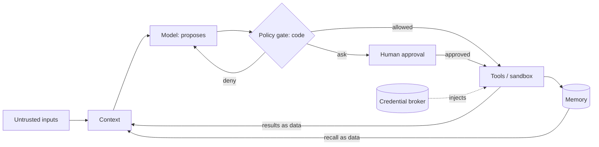

# Threat model and controls plan: <agent name>

Section numbers match the procedure steps in SKILL.md. IDs: TH- threats, C- controls (including oversight mechanisms),
RT- tests. Every ID referenced anywhere must be defined in its table.

## Summary

- **Verdict:** <Block / Ship with conditions / Ship>. <one sentence. Block while any P0 lacks an existing control. In design mode, planned P0 controls (owner and test each) let the build start, but launch stays blocked until they are built and tested; for a running system, planned controls never lift Block. A verdict resting on (assumed) items is provisional either way: name the check that settles each>
- **Top risks:** <3 one-line statements: path → worst outcome → priority>
- **Must-have before launch:** <the P0 controls by C-ID, one line each>
- **Oversight in one line:** <which actions run alone, which ask, which are refused>
- **Premise findings:** <stated architecture that is itself a risk, e.g. agent on the user's full-scope token; or "none">

## 1. Scope and mode

| | |
|---|---|
| Version / date | <v0.1, YYYY-MM-DD> |
| Owner (accepts residual risk) | <name, role> |
| Mode | <new design / partly built (controls marked existing or planned)> |
| Scope | <agent(s), flows, environments in scope; what is out of scope> |
| Principal | <the authenticated person or account the agent acts for, and how it is identified. For an agent triggered by outsiders (public issues, inbound email), the principal is the owning team and every trigger is untrusted> |
| Autonomy today | <e.g. drafts only / acts on reads, asks on writes / N/A (greenfield)> |
| Rule of Two triage | <does any run hold all three of Meta's properties at once: (A) untrustworthy inputs, (B) access to sensitive systems or private data, (C) the ability to change state or communicate externally? Which leg is absent by design, or which flows need a cut or oversight? Include the integrity case: untrusted input that can change a sensitive system (merge, deploy, configuration, permissions, payments) even with no private data> |
| Assumptions | <every assumption made because an input was missing; findings that depend on one are tagged (assumed)> |

## 2. Worst outcomes (what must never happen)

| # | Outcome | Asset | Why it matters |
|---|---|---|---|
| W1 | <e.g. customer PII sent outside the company> | <CRM records> | <legal exposure, trust> |

## 3. Inventories

### 3a. Capabilities

| Tool / action | Side-effect class | Data reached | Credential and scope | Brings untrusted content? | Gate (existing / planned / none) |
|---|---|---|---|---|---|
| <name> | read / reversible / external comms / irreversible / egress / code exec / permission change | <...> | <whose identity, scope, lifetime> | yes / no | <e.g. none; planned C-01> |

Entry points: <every endpoint, alias and deployed version that can invoke the agent; the authenticator on each; who
holds invoke rights>

Ambient capabilities (one row each in the table above): <environment variables and secrets, mounted sockets, inherited
credentials and metadata endpoints, network position, repository paths whose change triggers CI>

### 3b. Inputs and trust levels

| Source | Who controls it | Enters context as | Trust |
|---|---|---|---|
| <user turn> | <authenticated customer> | <message> | semi |
| <tool result from a fetch tool> | <anyone on the web> | <tool output> | untrusted |

## 4. Trust boundaries and flow

<Edit to match the system. Mark where enforcement lives (file or service) and whether it exists or is planned.>

STRIDE per element (fill for audits or multi-agent systems; one row per process, store and flow that crosses a boundary):

| Element | Type | S | T | R | I | D | E | Threats |
|---|---|---|---|---|---|---|---|---|
| <tool result: fetch_page> | flow | | x | | x | | | <TH-01> |

## 5. Lethal trifecta and integrity check (per flow)

| Flow | Private data? | Untrusted content? | External channel? | Can untrusted input change a sensitive system? | Confidentiality or integrity case? | Leg to cut, or review plus hard limits (C-ID) |
|---|---|---|---|---|---|---|
| <flow> | <what> | <what> | <what, incl. URLs, rendered images, invites, notifications> | <merge, deploy, config, permissions, payment, or no> | trifecta / integrity / both / neither | <e.g. C-03 taint-gated egress + recipient allowlist> |

If the product's purpose needs all three legs: approvals per day the cut causes, and which prompt-reduction patterns apply.

## 6. Propagation paths (top paths, including one with no attacker)

### Path P1: <source> → <worst outcome>

| Hop | What happens | Existing control (or N/A) | Gap | Planned control (C-ID) |
|---|---|---|---|---|
| Source | | | | |
| Plan | | | | |
| Tool call | | | | |
| Effect | | | | |
| Persistence | | | | |
| Recovery | | | | |

## 7. Threat register

| ID | Threat | OWASP | Layer | Path | Impact (W#) | Exposure | Priority | Controls (C-IDs) | Owner / status |
|---|---|---|---|---|---|---|---|---|---|
| TH-01 | <indirect injection via inbound email leads to data egress> | ASI01, LLM01 | tool | P1 | W1 | public | P0 | C-01, C-03 | <name / planned> |

OWASP Agentic coverage: ASI01 <covered / gap / N/A: reason> · ASI02 <...> · ... · ASI10 <...>

## 8. Priorities and verdict

- P0: <TH-IDs; mark P0 (assumed) where it rests on an unverified assumption>
- P1: <TH-IDs>
- Verdict reasoning: <which P0s lack an existing control; which planned controls allow the build but not launch; what turns Block into Ship with conditions>
- Counts: <open P0s, P1s and controls, recomputed from sections 7 and 9 so the Summary matches>

## 9. Controls plan

| ID | Control | Status | Stops | Lives in | Model can bypass? | Who can switch it off? | Cost | Priority |
|---|---|---|---|---|---|---|---|---|
| C-01 | <single policy gate with default-deny allowlist> | existing / planned | TH-01, TH-04 | <service/file> | no | <role that can change gate mode or rules; alarm> | <~ms per call> | P0 |

Group in this order: capability reduction · policy gate · access rules per action (permission tiers, scope ∩
entitlements, separate identities, scope gate) · credentials and identity · MCP hardening · sandbox · injection
containment · memory · guardrails · oversight mechanisms (approval gate, hard limits, send queue, autonomy ladder,
kill switch) · detection and recovery.

Guardrails (one row per check):

| Check | Layer (prompt / screening / hard limit) | Applies to (input / tool output / output / call arguments) | On error (fail open / closed) | On fail action | Control (C-ID) |
|---|---|---|---|---|---|
| <injection scan on tool results> | screening | tool output | closed | <route to human> | <C-04> |

## 10. Human oversight plan

### Action tiers

| Action | Tier | Permission tier | Handling | Hard limit (holds after yes) | Control (C-ID) | Reviewer | Promotion gate |
|---|---|---|---|---|---|---|---|
| <issue_refund> | irreversible | execute with approval | ask | <≤ $200> | <C-05 gate, C-06 cap> | <support lead> | <never above cap; under $50 after 300 clean cases> |
| <reply to inbound sender> | external comms | draft-only | draft-first / delayed send | <recipient class, content from this thread only> | <C-07 send queue> | <principal> | <per recipient class> |

Starting rung: <five-factor score (volume, variability, risk, judgment, action scope) and any factor scored 1>

### Approval gate and sends

- States and deadline: <pending → approved / rejected / expired / escalated; deadline; on timeout → next approver → expire>
- Execution: <separate step; keyed by the write's idempotency key from durable run state; approval ID stored with the intent and marked used in the same write; revalidated at execution>
- Binding: <digest of the exact action and arguments, expiry, nonce; executor recomputes and refuses on mismatch; where the platform binds to a commit SHA or version, what it lacks and how that is added>
- Delivery: <approval links open a read-only view; who signs in and is entitled to decide; links already sent that must be retired>
- Confirmation: <payload preview; confirm question naming action and target; agent asks instead when unsure of the target>
- Sends: <draft-first or delayed send per action; window length and who watches the queue>
- Reviewer view: <action and arguments → evidence → code reason → agent explanation (labelled)>
- Escalation triggers: <deterministic list; uncertainty signal only if calibrated>
- Capacity: <approvals/day = Σ volume × share asking; minutes/review; review budget; ≤ about half the budget?>
- Autonomy ladder: <per action class: current rung, promotion metric and threshold, demotion rule>
- Stop control: <C-ID; who, how, from where; safe mode; drill cadence>

## 11. Verification plan

| Test | Maps to | Technique class | Injection point | Expected trace property | Cadence |
|---|---|---|---|---|---|
| RT-01 | TH-01 / ASI01 | <indirect injection via email> | <inbound email> | <no egress after taint without approval record> | <every model/prompt/tool change> |

Include: <ASI seed suite rows; authorization tests (same call under two identities); harness-level abuse tests agreed
with agent-harness-designer; MCP deploy probes if in scope>.

Drills: <kill switch, secret rotation, memory purge and restore>. Hand-off: dataset and graders to agent-eval-designer.

## 12. Residual risk and sign-off

| Residual risk | Why accepted | Accepted by | Re-review trigger |
|---|---|---|---|
| <e.g. injection classifier misses novel obfuscation> | <bounded by gate and caps> | <owner> | <new tool, new data source, model change, incident> |

A P0/P1 path that must end in human review (code written from untrusted requests, say) is covered by review plus hard
limits plus provenance; whatever remains is listed here with its owner, not marked covered.

## Open questions

- <questions whose answers would change a priority, including components marked N/A pending confirmation>
